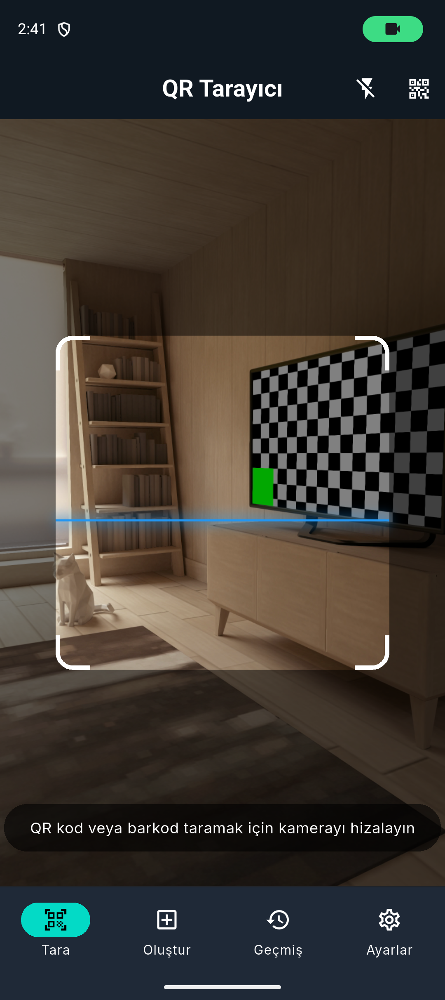
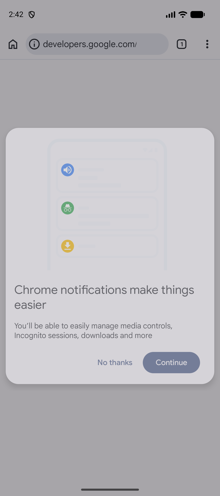
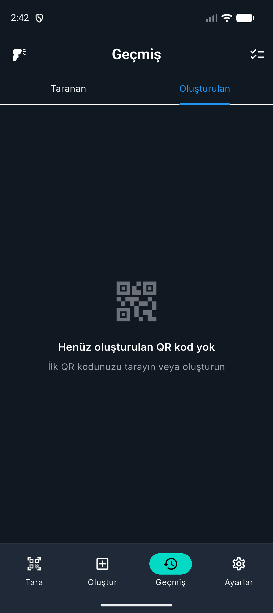
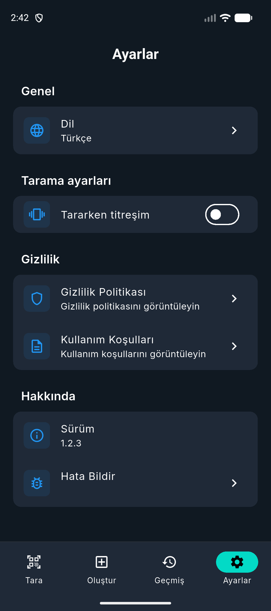

  

<h1 align="center">QR Scanner &amp; Generator</h1>

  A fast, private QR code and barcode scanner and a customizable QR code generator for Android and iOS, built with Flutter.

  
  
  

> The source code is private. This repository is a public overview of the project.

## Screenshots

  
  
  
  

## Features

- **Scan** QR codes and barcodes instantly, one at a time or in batch mode, with flash control.
- **Create** nine kinds of codes: links, text, Wi-Fi, contacts (vCard), email, SMS, phone, location and social profiles.
- **Customize** colors, gradients, eye and module shapes and logos; a contrast check warns before a code becomes hard to scan.
- **Understands what it scans**: opens links, joins details for Wi-Fi, calls, messages, emails and maps, and keeps Wi-Fi passwords hidden until you reveal them.
- **History** of scanned and created codes, redrawn from their saved design.
- **17 languages** and light, dark or system theme.
- **Private by design**: history stays on the device, no account needed; consent screens for ads and analytics where required.

## Under the hood

| Area | Approach |
| --- | --- |
| UI | Flutter, Material 3, adaptive layouts for phones, tablets and foldables |
| State and DI | Provider; every service is created once at startup and injected |
| Storage | Drift (SQLite) on device; QR designs stored as data, not images |
| QR rendering | Custom painter on top of `package:qr`; every style is verified by decoding it with ZXing in tests |
| Scanning | `mobile_scanner` with a lifecycle-aware camera and a matching scan window |
| Privacy | Google UMP consent (EEA/UK, US states), App Tracking Transparency on iOS, analytics off until consent |
| Delivery | Codemagic CI, TestFlight, Swift Package Manager on iOS, AGP 9 on Android |

## Links

- Privacy policy: https://gist.github.com/Atakan0zkan/a291804eae06c36c1ac7157bad1eb4cb
- More of my mobile work: https://atakanozkan.com/tr/mobileapps
- Contact: atakanozkanapps@gmail.com
